# Frcistan 1.0

**FRC / FTC robot parçası bayileri için stok yönetim programı.**
Motorlar, motor sürücüler, swerve modülleri… Hangi parçadan kaç tane kaldığını, değerini ve kimin ne zaman satış yaptığını saniyeler içinde görün.

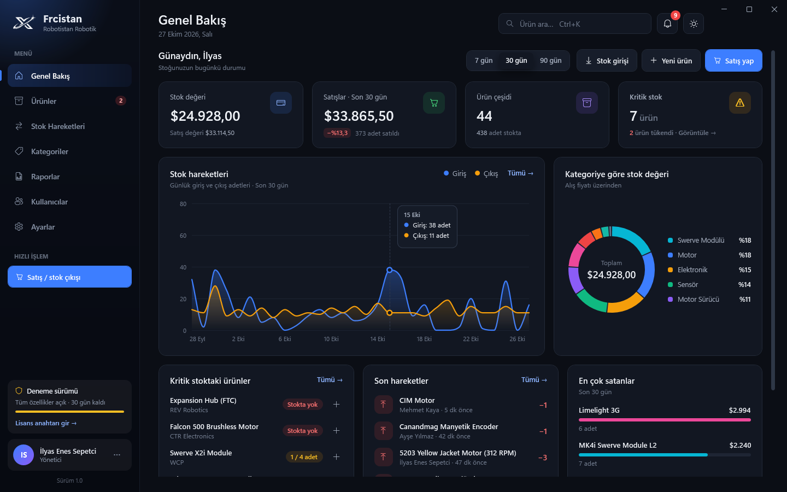

Frcistan 0.1'in (WinForms + XAMPP) baştan yazılmış, satışa hazır sürümüdür. Windows 10 / 11 için, .NET 10 + WPF ile geliştirildi.

---

## Öne çıkanlar

| | |
|---|---|
| **Kurulum gerektirmez** | Veriler yerleşik veritabanında (SQLite) saklanır. XAMPP ya da .NET kurmaya gerek yoktur. İsteyen MySQL / MariaDB sunucusuna bağlanıp ağdaki bütün bilgisayarlardan aynı stoğu kullanabilir. |
| **Stok hareketleri** | Her giriş, çıkış (satış) ve sayım düzeltmesi kim, ne zaman, kaç adet ve hangi fiyatla bilgisiyle kaydedilir. Stok asla eksiye düşmez; iki kişi aynı anda satış yapsa bile tutarlı kalır. |
| **Kritik stok uyarıları** | Her ürünün kendi kritik seviyesi vardır. Bildirim zili, menü rozeti ve tek tıkla sipariş listesi. |
| **Genel bakış paneli** | Stok değeri, dönem satışları (önceki dönemle karşılaştırmalı), 30 günlük giriş/çıkış grafiği, kategori dağılımı, en çok satanlar. |
| **Raporlar** | Stok listesi, sipariş listesi, hareket raporu, kategori değerlemesi, sayım formu. Gerçek **Excel (.xlsx)** çıktısı ve **yazdır / PDF**. |
| **Kullanıcılar ve yetkiler** | Yönetici ve Personel rolleri. Şifreler PBKDF2 ile şifrelenir, hatalı girişlerde geçici kilit. |
| **Yedekleme** | Günlük otomatik yedek (son 14 yedek saklanır), tek tıkla yedek alma / geri yükleme. SQLite ↔ MySQL arasında taşınabilir. |
| **Lisans sistemi** | 30 günlük deneme sürümü, imzalı lisans anahtarları ve anahtar üretme aracı. |
| **Modern arayüz** | Koyu ve açık tema, akıcı geçişler, klavye kısayolları, Türkçe karakter duyarsız anlık arama. |
| **0.1'den geçiş** | Eski sürümün XAMPP veritabanındaki ürün, kategori ve kullanıcılar tek tıkla aktarılır. |

## Ekran görüntüleri

| | |
|---|---|
| 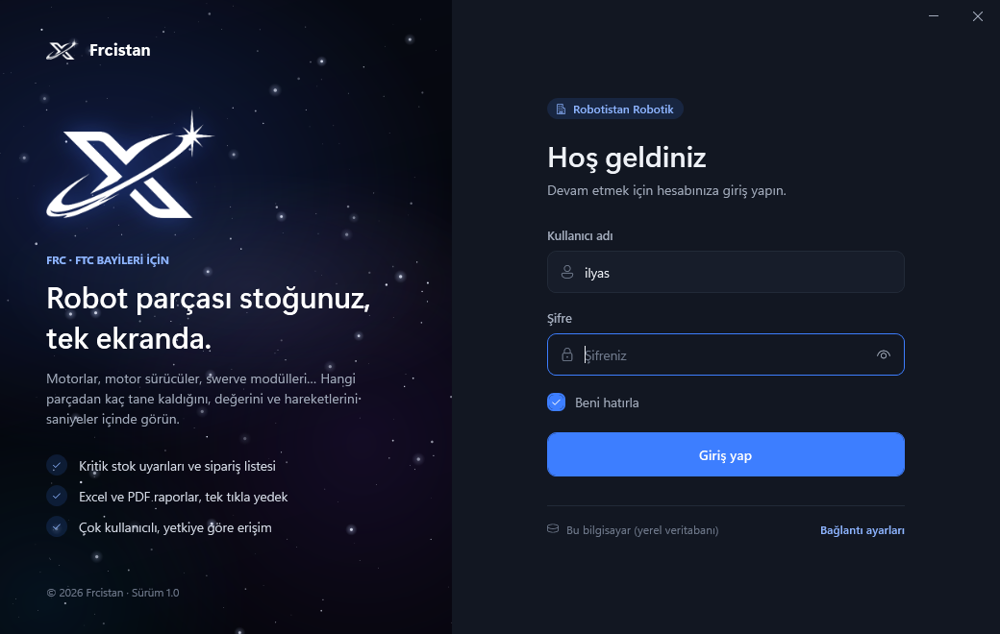 | 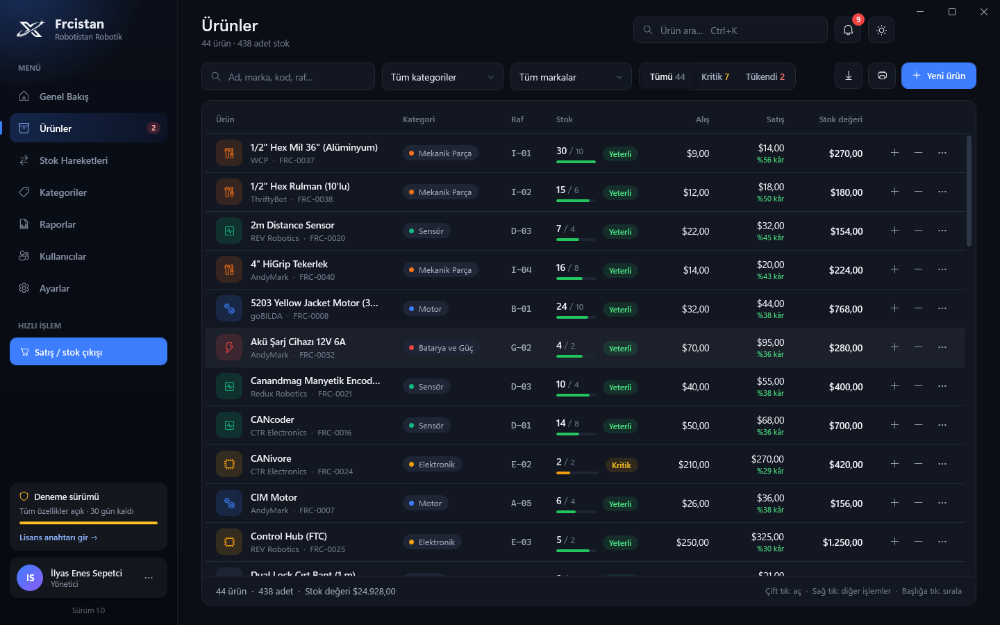 |
| Giriş ekranı | Ürünler: filtreler, stok durumu, kâr marjı |
| 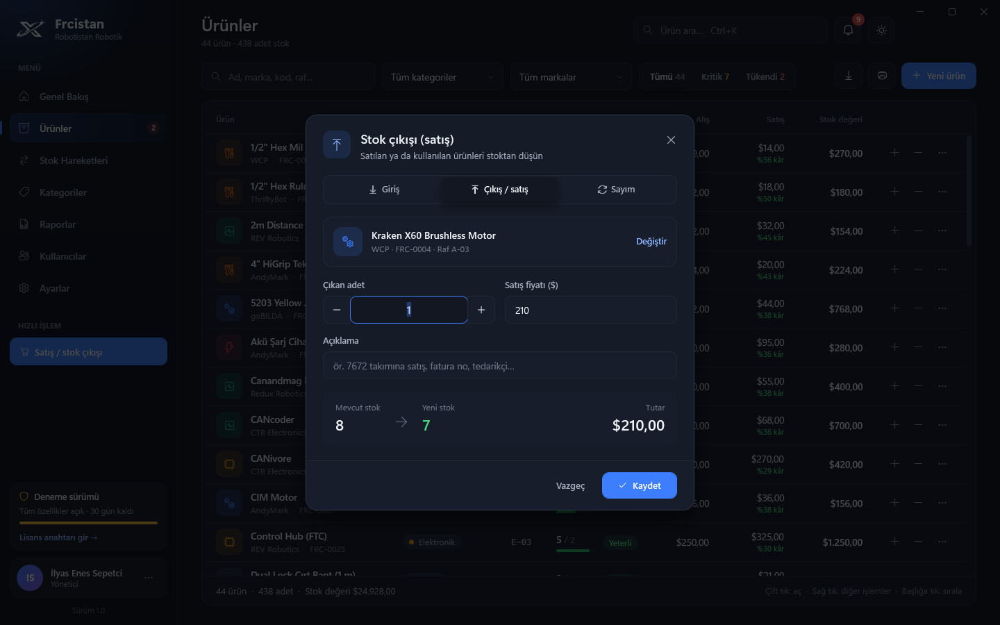 | 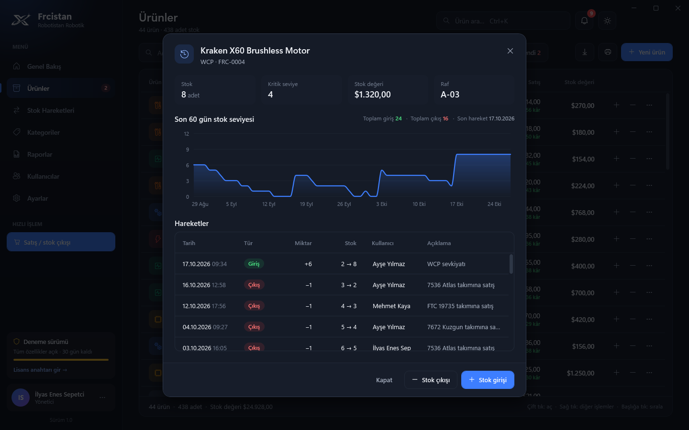 |
| Satış / stok çıkışı | Ürün geçmişi ve 60 günlük stok grafiği |
| 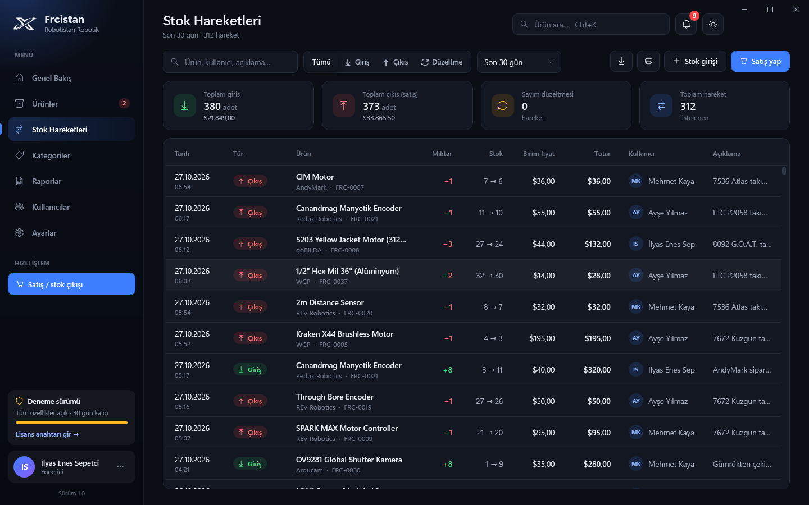 | 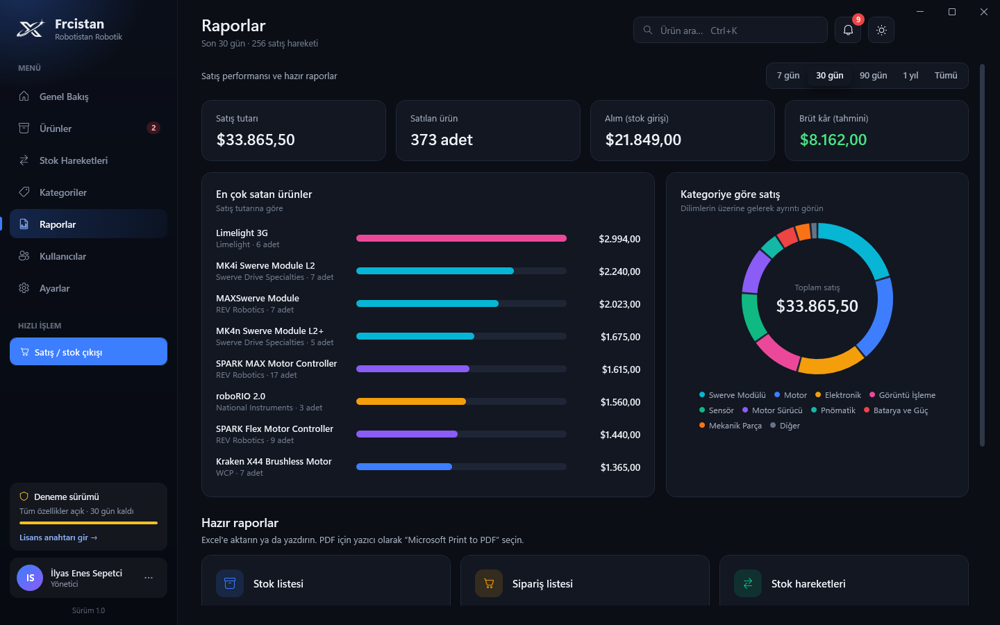 |
| Stok hareketleri | Raporlar |
| 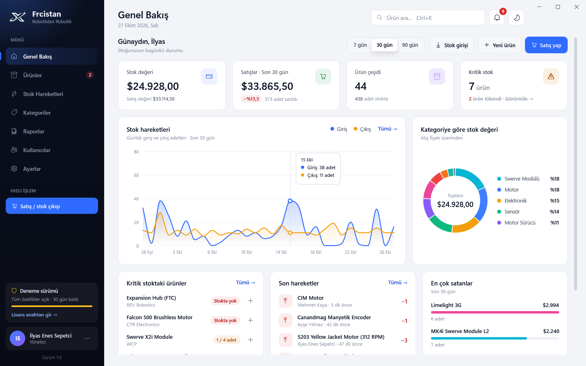 | 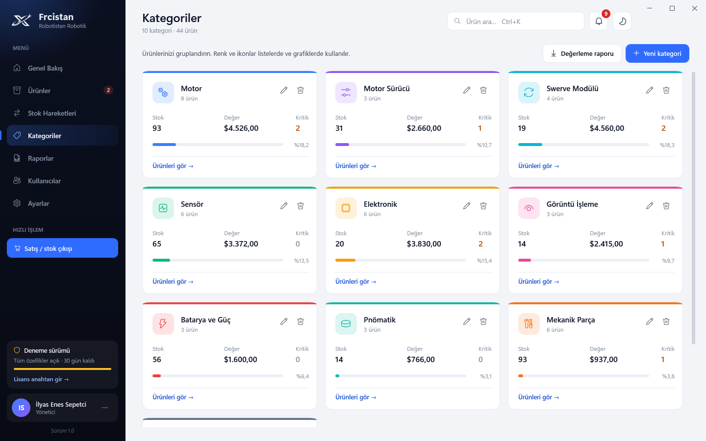 |
| Açık tema | Kategoriler |
| 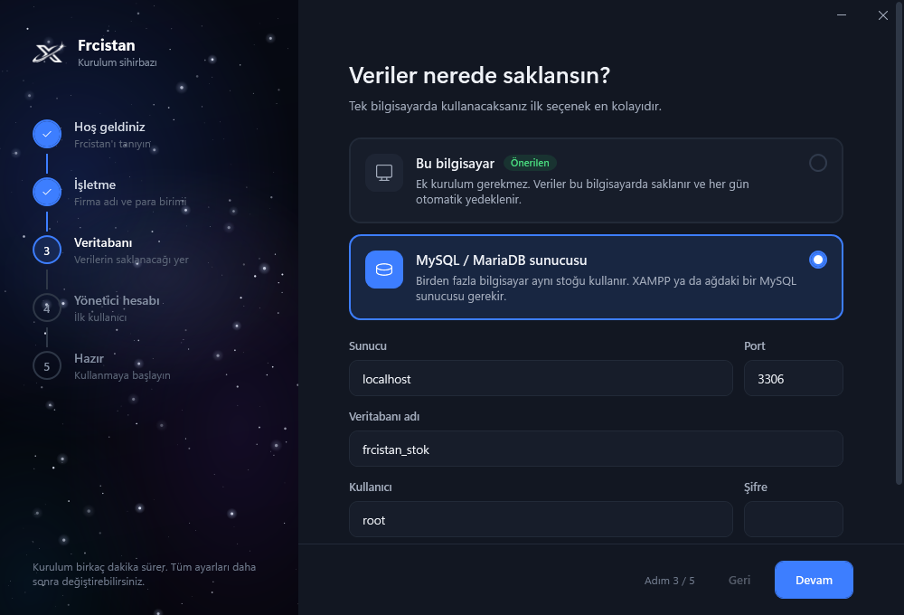 | 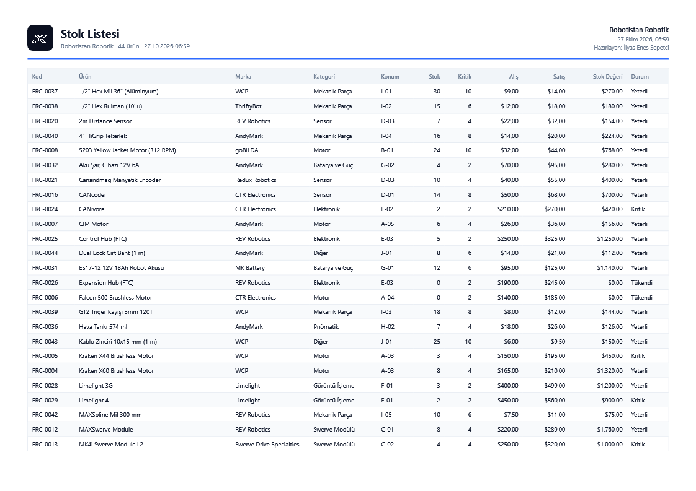 |
| İlk kurulum sihirbazı | Yazdırılan stok listesi |

---

## Müşteriye kurulum

1. `Frcistan-1.0-Kurulum.exe` dosyasını çalıştırın (yönetici izni gerekmez).
2. Program ilk açılışta **kurulum sihirbazını** gösterir: firma adı ve para birimi → verilerin nerede saklanacağı → yönetici hesabı.
3. İsterseniz “Örnek verilerle başla” seçeneğiyle 44 örnek ürün ve 2 aylık hareket geçmişiyle tanıtım yapabilirsiniz.

Birden fazla bilgisayar aynı stoğu kullanacaksa sihirbazda **MySQL / MariaDB sunucusu** seçilir (XAMPP'ta MySQL'i başlatmak yeterli). İkinci bilgisayarda aynı veritabanı seçilince sihirbaz bunu fark eder ve mevcut hesaplarla giriş yapılır.

### Örnek verideki hesaplar
Örnek verilerle kurulumda yöneticiye ek olarak iki personel hesabı oluşur: `ayse.yilmaz` ve `mehmet.kaya` (şifre: `Demo1234`). Gerçek kullanımda bu hesapları **Kullanıcılar** sayfasından silin.

## Lisans sistemi (satış için)

- Yeni kurulum **30 gün deneme** sürümüdür; tüm özellikler açıktır.
- Süre bitince kayıtlar korunur ve görüntülenebilir, ancak ekleme / değişiklik için lisans gerekir.
- Lisans, veritabanında saklanır; aynı veritabanını kullanan tüm bilgisayarlarda geçerlidir.

**Lisans anahtarı üretmek:**

```powershell
cd araclar\LisansUretici
dotnet run -- "Müşteri Firma Adı"                      # süresiz
dotnet run -- "Müşteri Firma Adı" --bitis 2027-12-31   # süreli
```

Çıkan `FRC1.…` anahtarını müşteriye gönderin; müşteri **Ayarlar › Lisans** bölümüne yapıştırır. Verilen lisanslar `verilen-lisanslar.txt` dosyasına da yazılır.

> ⚠️ `araclar/LisansUretici/ozel-anahtar.txt` **gizli anahtardır**. Kimseyle paylaşmayın, yedeğini güvenli bir yerde saklayın. `.gitignore` sayesinde GitHub'a yüklenmez. Kaybederseniz yeni anahtar üretip (`dotnet run -- --anahtar-uret`) programdaki açık anahtarı (`src/Frcistan/Servisler/LisansServisi.cs`) güncellemeniz gerekir; eski lisanslar geçersiz olur.

Kendi bilgisayarınızda deneme süresine takılmamak için kendinize de bir lisans üretebilirsiniz.

## Geliştirme

Gerekenler: **.NET 10 SDK** ve Visual Studio 2026 (ya da VS Code / Rider).

```powershell
dotnet run --project src/Frcistan            # programı çalıştır
```

`Frcistan.slnx` dosyasını Visual Studio'da açıp F5'e de basabilirsiniz.

**Ekran görüntüsü modu (yalnızca Debug):** geçici bir veritabanı ve örnek verilerle bütün ekranların PNG görüntüsünü alır; tanıtım broşürü ve mağaza sayfası için kullanışlıdır.

```powershell
dotnet build src/Frcistan
src\Frcistan\bin\Debug\net10.0-windows\Frcistan.exe --ekran-goruntusu C:\ekranlar
```

### Kurulum dosyası üretmek

Bilgisayarda [Inno Setup 6](https://jrsoftware.org/isdl.php) kurulu olmalı.

```powershell
dotnet publish src/Frcistan/Frcistan.csproj -p:PublishProfile=Kurulum
```

Önce tek parça `yayin\Frcistan.exe` (≈70 MB, .NET içinde) oluşur, ardından `kurulum-cikti\Frcistan-1.0-Kurulum.exe` üretilir. Sürüm numarası `src/Frcistan/Frcistan.csproj` içindeki `<Version>` alanındadır.

## Veriler nerede?

| | |
|---|---|
| Veritabanı (yerel) | `%LOCALAPPDATA%\FrcistanStok\Veri\frcistan.db` |
| Ayarlar (bu bilgisayar) | `%LOCALAPPDATA%\FrcistanStok\ayarlar.json` |
| Otomatik yedekler | `%LOCALAPPDATA%\FrcistanStok\Yedekler\` |
| Hata günlüğü | `%LOCALAPPDATA%\FrcistanStok\gunluk.txt` |

Program kaldırılınca veriler silinmez. MySQL şifresi Windows DPAPI ile şifrelenerek saklanır.

## Klavye kısayolları

| Kısayol | İşlev |
|---|---|
| `Ctrl + K` | Ürün ara |
| `Ctrl + S` | Hızlı satış / stok çıkışı |
| `Ctrl + N` | Yeni ürün (Ürünler sayfasında) |
| `Ctrl + 1…7` | Menü sayfaları |
| `F5` | Sayfayı yenile |
| `Esc` | Açık pencereyi kapat |

## Proje yapısı

```
Frcistan.slnx
src/Frcistan/
  Altyapi/        MVVM temeli, diyalog/bildirim sistemi, tema, dönüştürücüler
  Modeller/       Urun, Kategori, StokHareketi, Kullanici, Ayar
  Veri/           EF Core bağlamı, veritabanı hazırlama, örnek veri
  Servisler/      Ürün/stok/kategori/kullanıcı servisleri, Excel, yazdırma, yedek, lisans, 0.1 aktarımı
  ViewModels/     Sayfa ve diyalog mantığı
  Pencereler/     Giriş, kurulum sihirbazı, ana pencere
  Sayfalar/       Genel bakış, ürünler, hareketler, kategoriler, raporlar, kullanıcılar, ayarlar
  Diyaloglar/     Ürün, stok, kategori, kullanıcı, şifre, veritabanı, lisans…
  Kontroller/     Alan grafiği, halka grafik, yıldızlı arka plan, diyalog çerçevesi
  Temalar/        Koyu/açık renkler ve tüm kontrol stilleri
araclar/LisansUretici/   Lisans anahtarı üretme aracı
kurulum/                 Inno Setup betiği ve sihirbaz görselleri
docs/ekran-goruntuleri/  Ekran görüntüleri
```

**Teknolojiler:** .NET 10, WPF, Entity Framework Core 10, SQLite, MySQL Connector (MySQL / MariaDB), ECDSA imzalı lisans. Arayüzde dış bileşen kütüphanesi kullanılmadı; grafikler ve stiller projeye özeldir.

---

Geliştiren: **İlyas Enes Sepetci** · © 2026
